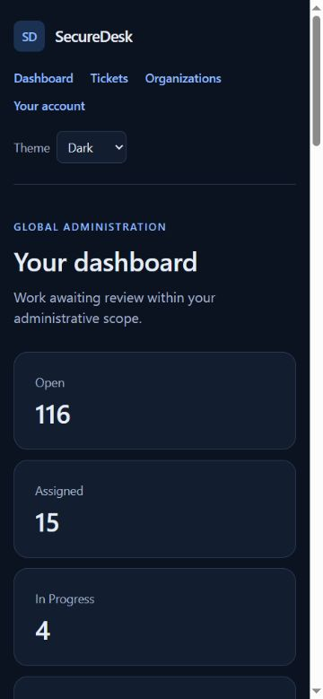

# SecureDesk

A client support portal for a small IT support agency, built from an approved specification. Database permissions and authorization tests precede each business module.

The product name is **SecureDesk**, consistent with the approved specifications and verification records. The [portfolio case study](https://stackcipher.rollacatfull.chatgpt.site/projects/securedesk/) introduces the project. [Project documentation](docs/SECUREDESK_DOCUMENTATION.md) describes the live workspace, the fictional interactive walkthrough and their current access status.

**Status — 25 October 2026:** The agreed private, access-protected demo verification is complete. [Closed-demo acceptance](docs/PHASE7_CLOSED_DEMO_ACCEPTANCE.md) records hosted roles/files/workflows, dated preservation/recovery evidence and the final Vercel cron GET200 observation, with explicit limits. A separate [fictional interactive demo](https://secure-desk-eta.vercel.app/demo) is now publicly accessible without an account; the real workspace retains its application authentication and company permissions. The repository remains private. This is not a production-security certification or a fresh dependency-advisory assessment.

The GitHub source synchronization includes the current SecureDesk introduction, fictional demo and English documentation. Its maintenance schedule matches the published application: 08:30 UTC (`30 8 * * *`). This update supersedes the earlier code-only mirror restriction and notes about its older cron setting. Historical test records and private evidence retain their original scope.

## Implemented workflows

- Email-confirmed pending registration and administrative approval.
- Organizations, membership requests, access codes and transactional transfers.
- Separate Client membership, Staff assignments and organizational Admin assignments.
- Projects, General Support and proposals with reviewer recommendations and Admin decisions.
- Tickets with ownership, collaboration, controlled sharing and a 15-minute comment edit window.
- Resolved, reasoned reopen requests, terminal Closed and audited scheduled closure.
- Private attachments: content validation, 10 MiB limit and current parent permissions.
- Scoped audit history, 365-day default retention, English UI and light/dark themes.

Email confirmation establishes identity; company access still requires approval.

## Stack and architecture

Next.js App Router, TypeScript, React, Tailwind CSS, Supabase Auth, PostgreSQL 17, RLS, private Storage and pg_cron. Node 24 LTS is required; the lockfile records dependency versions.

~~~mermaid
flowchart TD
  Browser[Browser] --> App[Next.js: verified identity and validated input]
  App --> RPC[Authenticated business RPCs and RLS]
  RPC --> DB[(Current role and parent permissions)]
  RPC --> Audit[(Scoped audit)]
  App --> Grant[Reserve one upload]
  Grant --> Browser
  Browser -->|scoped upload capability| Temp[(Private quarantine)]
  App -->|validate content and recheck access| Temp
  App -->|immutable validated copy| Files[(Private attachments)]
  App -->|authorized verified download stream| Browser
  Workers[Restricted database workers] --> DB
  Workers --> Audit
~~~

[Architecture](docs/ARCHITECTURE.md) · [Security report](docs/SECURITY_REPORT.md) · [Deployment plan](docs/DEPLOYMENT_PHASE7.md)

## Local screenshot

Local application with fictional verification data; this is not a hosted demo.

## Run locally

Install Node 24 LTS and Docker Desktop, then open this repository in VS Code.

~~~text
npm ci
npm run db:start
~~~

On a new machine copy .env.example to .env.local and fill it locally from your own Supabase stack. Use SITE_URL=http://127.0.0.1:3000. The server-only Storage key must belong to the same local project. Do not commit credentials. CRON_SECRET is a random server-only value of at least 32 characters, required when exercising maintenance.

~~~text
npm run supabase -- migration up --local
npm run dev
~~~

Open http://127.0.0.1:3000. Studio uses port 54323; Mailpit uses 54324. Use the same exact origin for cookies and confirmation links. Confirmed new users remain pending.

There are **27 migrations, 22 public RLS tables and three private buckets**. Preserve a populated database: migration up applies pending files without resetting users or uploaded files.

[Migration runbook](docs/MIGRATION_RUNBOOK.md) documents administrator setup, fictional fixtures and safe repeat checks. The bootstrap script refuses hosted targets.

## Verification

| Scope | Result |
| --- | --- |
| Phase 6 full local verification, 8 October | 4,177 SQL; 4,390 real Auth/API/native HTTP across 19 suites; 51 unit assertions — PASS |
| Phase 7 schema regression, 9 October | 4,204 SQL assertions across 23 files — PASS |
| Phase 7 affected attachment workflows | 389 ticket + 400 proposal Auth/API/Storage/HTTP assertions — PASS |
| File validation and streaming | 38 unit assertions — PASS |
| Lint, types, build and browser | See current Gate 7 record |
| Dependency audit, 9 October | 0 known production findings; five development package entries from one unpatched High advisory |

Assertion counts are not numbers of users or requests. Earlier gates are dated evidence; Phase 7 repeats the workflows affected by hosting changes.

~~~text
npm run lint
npm run typecheck
npm run build
npm run db:test
npm run test:attachments
npm run test:attachments:transfer
~~~

After starting the local production build:

~~~text
npm run check:tickets:attachments:web -- --create-demo
npm run check:organizations:proposals:web -- --create-demo
~~~

Fixture suites retain fictional business history, revoke temporary privileged roles and sessions, and refuse hosted targets. Run them sequentially.

[Gate 6](docs/GATE6_VERIFICATION.md) · [Gate 7 progress](docs/GATE7_VERIFICATION.md)

## Security and deployment limits

RLS and narrow RPCs check current stored permissions. Application roles cannot directly write business tables or read private Storage bytes. Download links recheck access; sharing a URL does not share permission. Privileged keys remain server-only.

Vercel's 4.5 MB function payload limit requires large files to upload directly to private quarantine. The server validates content before immutable publication. Guarded downloads stream verified bytes. Actual Vercel upload/download behavior still requires hosted verification.

The auth limiter is per process, not shared across serverless instances. Provider controls and SMTP require configuration before public registration. Issued JWTs retain the provider lifetime after logout; business permissions are checked against the current database.

The development-only braces advisory is disclosed. Content validation is not antivirus scanning. Local evidence is not production security certification or a formal WCAG audit.

## Documents

- [Approved roadmap](docs/spec-v1-approved/DEVELOPMENT_ROADMAP.md) — unchanged business decisions.
- [Security report](docs/SECURITY_REPORT.md), [architecture](docs/ARCHITECTURE.md), [migration runbook](docs/MIGRATION_RUNBOOK.md).
- [Phase 7 plan](docs/DEPLOYMENT_PHASE7.md), [verification record](docs/GATE7_VERIFICATION.md), [portfolio drafts](docs/PORTFOLIO_DRAFTS.md).
- [Learning guide](docs/LEARNING_GUIDE.md) and [workspace history](docs/LOCAL_SETUP.md).

Credentials, local user data, private evidence and uploaded test files are excluded from this repository.

Historical GitHub scope, 9 October: the original code-only export excluded Markdown files and retained a separate history. On 25 October the owner authorized synchronizing the current application and English documentation to this private repository. Credentials, private verification artifacts and recovery material remain excluded.
