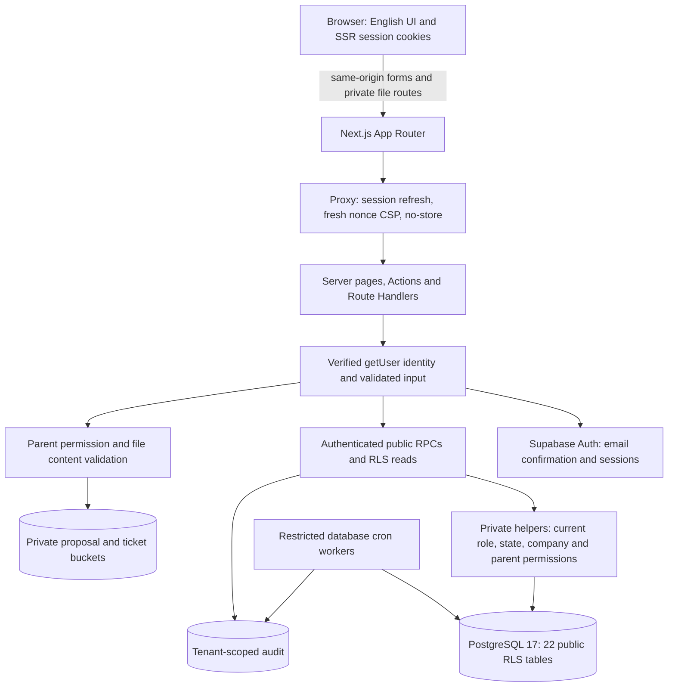

# SecureDesk — architecture after Phase 6

Local implementation, 8 October 2026. Business authority remains the unchanged seven documents in spec-v1-approved/. This diagram describes the implementation; it does not change their permissions.

## Request and trust boundaries

1. UI visibility is a convenience. Every page obtains a verified identity on the server, every mutation validates its input, and PostgreSQL checks current stored permissions again. Caller metadata, URL IDs and hidden inputs cannot grant a role.
2. Supabase Auth stores credentials and confirmed identity; profiles stores the business role and account state. Email confirmation leaves a new Client pending until administrative approval. Membership, Staff assignment and organizational Admin assignment are separate permissions.
3. Server Actions use the caller's authenticated Supabase client. They call narrow transaction RPCs with explicit fields and expected revisions/scopes. Direct table writes are denied to application roles. RLS narrows readable rows; four sensitive organization-code/transfer tables are RPC-only.
4. SECURITY DEFINER functions have an empty search_path, explicit object names and restricted EXECUTE grants. They derive the actor from auth.uid(), verify current role/state/scope and preserve business/audit atomicity. They never accept a caller-supplied authoritative actor.
5. The server-only Storage key operates on private bytes after the caller's parent permission has been checked. It is never used for ordinary user business reads or approval decisions. Download is a checked application route with no shared caching; passing a file URL to someone does not grant access. Repeated parent checks and expected scopes cover revocation races. Uploads enforce the documented content allowlist and 10 MB limit before trusted completion.
6. Database workers close only eligible Resolved tickets without pending reopen requests and purge only expired audit records under the serialized retention policy. They are not browser-callable. Local schedules are one-minute closure and daily 03:15 GMT retention. Closed is terminal.

## Browser and sessions

The Proxy refreshes cookies using the installed SSR adapter. It generates and forwards a fresh nonce, overrides incoming nonce/CSP values, and sends the response CSP. The root layout is dynamic so HTML and framework scripts use that request's nonce. Production does not allow unsafe-inline or unsafe-eval. Development allows the framework's required evaluation. Exact configured Supabase origins are used for connect-src. Security headers also cover static resources; authenticated HTML is private/no-store. HSTS is emitted for an HTTPS deployment, not local HTTP.

SSR cookies are readable by the supported browser SDK; they are not described as HttpOnly. SameSite=Lax and Secure on HTTPS, origin-checked native Actions, explicit checks on file routes, plain text React rendering, and CSP provide complementary protections. Supabase access tokens last 3600 seconds and refresh tokens rotate. A business permission change is checked immediately against database state; a JWT already issued before logout has the provider's remaining lifetime for direct API use. Application pages reverify getUser. See SECURITY_REPORT.md for the limits.

## Abuse controls

Application auth Actions limit login to 10 attempts per normalized email per 10 minutes, registration to 3 per 10 minutes, resend to 1 per minute, and confirmation to 5 per token per 5 minutes. The bounded in-memory map stores process-salted HMAC subjects, uses a monotonic clock and fails closed at capacity. It ignores caller-controlled forwarding headers. It resets on restart and is not shared between replicas. Supabase provider limits also protect its direct Auth endpoints; shared or edge limits are a separate deployment concern.

## Source map

| Responsibility | Sources |
| --- | --- |
| Browser policy | proxy.ts, next.config.ts, lib/security/headers.ts |
| Auth validation, attempts, session clients | app/auth/actions.ts, lib/auth/, lib/security/, lib/supabase/ |
| Business decisions | supabase/migrations/, lib/* server read models, app/*/actions.ts |
| Parent-based file access | lib/attachments/, lib/supabase/storage-server.ts, proposal/ticket attachment Route Handlers |
| Permission proof | supabase/tests/, scripts/check-*-web.mjs, scripts/check-security-web.mjs |
| Gate and deployment boundary | GATE6_VERIFICATION.md, SECURITY_REPORT.md, MIGRATION_RUNBOOK.md |

The architecture is a local demonstration. Hosted TLS, SMTP, infrastructure isolation, backups and multi-instance abuse controls must be verified in Phase 7 before exposure.

## Phase 7 adaptation — 9 October 2026

Browser uploads large files to a separate private quarantine bucket using a scoped capability. The server validates content, publishes an immutable permanent copy and invokes the existing permission/revision-checked completion. Guarded downloads stream verified bytes. Service-only daily maintenance removes old quarantine/orphan bytes; business table grants remain restricted. The diagram above describes Phase 6; the current README and [DEPLOYMENT_PHASE7.md](DEPLOYMENT_PHASE7.md) show the new boundary.
