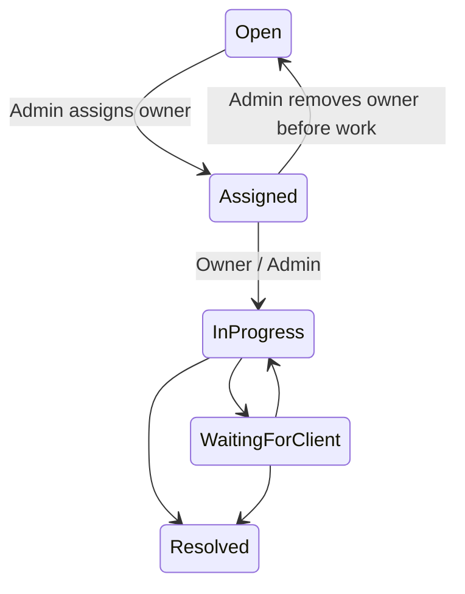

# SecureDesk — learning through development

This guide is in English. The text in the application is in English, according to the approved specification. The goal is to understand the decisions and checks, not just to get the finished code.

## How to read project phases

The Roadmap has Phases 0–7. A phase is a larger whole; the task is a verifiable part of that whole. Gate is the final check of conditions for moving on. "The code is written", "the tests passed" and "the entire phase is complete" are not the same.

| Phase | What we learn and build | How we know it is ready |
| --- | --- | --- |
| 0 — specification |First, we agree business rules: who is allowed to do what, which data belong to which company and which statuses exist.|The documents are mutually aligned and approved.|
| 1 — skeleton |Environment, application structure, Git, configuration and local database. A public key is not a substitute for permissions; the privileged key remains on the server.|The application works locally, secrets are not in Git, and the migration process is verified.|
| 2 — identity and access |Registration, email confirmation, business approval, roles and RLS. A verified email does not mean an approved company role.|Positive and negative tests of all roles; there is no self-service promotion.|
| 3 — organizations and projects |Memberships, Staff/Admin assignments, codes, transfers, General Support and private proposals. The code initiates the request; it does not grant access.|Gate 3 confirms prohibition of direct Client project activation and immediate revocation on transfer.|
| 4 — tickets |Concrete work: ticket, owner, collaborators, statuses, dashboard, comments and approved sharing. Company membership alone is not a right to every ticket.| Gate 4 checks A/B isolation, two clients of the same company, unassigned Staff, and the real on-behalf actor. |
| 5 — attachments and closure |Private ticket files, solution acceptance, reopen request, seven-day deadline, scheduled work and broader audit coverage.|Format/access checks, timing checks, and concurrency checks between user actions and automation.|
| 6 — hardening |We systematically search for vulnerabilities: IDOR, CSRF, XSS, sessions, rate limiting, dependencies, accessibility. We also document the remaining limitations.|Critical/high findings are resolved or clearly marked; there is a security report.|
| 7 — demo and portfolio |Separate demo deployment with fictional data, clear README and showcases.|Public demos/repos do not publish secrets or private data; the description matches proven capabilities.|

The current state of individual phases is checked in `LOCAL_SETUP.md` and Gate documents. This table explains the plan; it is not a confirmation that future phases have been implemented.

## Phase 4: seven tasks

The five roadmap items are broken down into seven tasks for overview learning. Creation and tenant invariant are task 1; assignment/status/priority task 2; access and Gate tests task 3; business screens task 4; dashboard task 5; comments task 6; sharing task 7. Status and specific results are recorded in `TICKETS_PHASE4.md` and `GATE4_VERIFICATION.md`.

### 1. Ticket foundation and two author types

Imagine that Ana is a client of company A, and Marko is a support employee. Ana opens a ticket: `client_user_id=Ana` and `created_by_user_id=Ana`. If Marko opens the ticket on Ana's behalf: `client_user_id=Ana`, `created_by_user_id=Marko`. Ana sees it as her ticket, while the history records Marko as its actual creator.

`organization_id` is a company, that is, a tenant. `project_id` is a project within that company. The composite foreign key `(organization_id, project_id)` compares both values ​​to the project. That is why the combination of "company A + project of company B" cannot pass even if the application fails.

A simple foreign key would only prove that the project exists. The composite key also proves that it belongs to the same company. A controlled function checks the project's active status and the client's actual approved membership. The historical client remains recorded after a transfer, but this does not preserve their access.

A new ticket has status `Open`, priority `Medium`, and no owner. Client-supplied values for status, priority, or actor are not trusted. Those values come from database rules and the verified session.

Check: creating one's own ticket succeeds; impersonating another client, using another company's or an inactive project, using a Pending account, and submitting forged privileged fields are rejected.

### 2. Owner, collaborators, and statuses

The owner is the responsible Staff member. An additional Staff collaborator is explicitly recorded in `ticket_collaborators`. Assignment to an organization permits viewing its projects and creating tickets on a client's behalf, but does not permit viewing every ticket. Even the separate permission to create projects does not grant ticket privileges.

Admin sets the owner. Owner can add Staff associates of the same company. The associate reads and comments, but does not prioritize or resolve the ticket. Changing owner immediately changes access, unless the former owner has a separate explicit collaborator assignment.

Workflow:

"InProgress" and "WaitingForClient" in the diagram represent UI statuses `In Progress` and `Waiting for Client`. It is not allowed to skip `Assigned` and directly close a new ticket. The priorities are `Low`, `Medium`, `High`, `Critical`; they are determined by the owner or competent Admin.

The scheme recognizes all six statuses, including `Closed`. Phase 4 gives work until `Resolved` and no return from `Closed`. Special paths for acceptance, exceptional administrative closure, reopen, and automation come in Phase 5. Generic status operations must not serve as a shortcut for those paths.

### 3. Access and negative tests

We check five things: who is logged in, whether their account is active, what role they have, which company they currently belong to, and what assignment they have on the specific ticket. All are important; the `staff` role alone is not enough.

RLS stands for Row Level Security: the database filters the rows before returning them to the user. Client Ana doesn't see Petar's tickets from company A just because they have the same company. Staff Marko does not see Ana's ticket until he is an owner or associate. OA only sees the tickets of the companies it administers; SA has a global scope.

The server rechecks the session and calls dedicated DB functions. Direct `INSERT/UPDATE/DELETE` over business tables are not assigned to application users, not even business SA. Each function determines the actual actor from the session, checks permissions, and writes an audit in the same transaction.

Positive test: Ana sees her ticket. Negative test: Petar changes the ID in the URL to Ana's ticket and gets an unavailable view. IDOR is a loophole where changing the identifier allows access to someone else's object. We check it both between companies and between two clients of the same company.

Transfer and revocation are checked with the same JWT/cookie. The user does not have to log out first to lose access. The membership is read again, instead of the old company being written as a permanent right in the session.

### 4. Screens and Server Actions

The list shows only available tickets. Creation requires a project; Staff/Admin also selects an approved client. The detail shows the problem, the owner, the original Client identity and the actual creator. The change form is only displayed if it is allowed, but the server checks the permission even if someone copies it.

A Server Action is a function on the server that processes the form. Hidden fields are not reliable: the user can change their content. That's why hidden `organization_id` or `revision` serve as a requirement and protection against outdated changes, not as proof of rights.

`revision` is the version of the record. Two people load version 3; the first saves the change and makes version 4. A second attempt with version 3 is rejected, instead of seamlessly overriding the newer change. We use a unique submission ID for creation: the same repeated request does not create another ticket or audit event.

Lists have 25 results and one extra line as a "there is a next page" signal. A selection search also has a limited number of results. This preserves readability and prevents unlimited loading of the company directory.

### 5. Dashboard

The client receives his own and specially distributed tickets, their statuses and projects of his company. Staff gets assigned tickets and decisions to process. Admin gets work queues in its range: registrations, proposals, transfer, unassigned tickets and sharing requests.

The number on the card is also data. If Petar is not allowed to see Ana's ticket, he should not know that it exists through the total number of tickets. Therefore, an aggregation uses the same access checks as a list. Dashboard is not a new notification system; it is a review of already existing work.

### 6. Comments and 15-minute revisions

The comment is visible to everyone who currently has access to the parent ticket. There is no special internal Staff-only comment. The author can modify it only before the expiration of 15 minutes from creation. The server measures the deadline with its own time; changing the clock in the browser does not help.

When changing, the previous text is entered in `ticket_comment_revisions`, and the current text is updated in the same transaction. Audit saves that a change has occurred, but does not copy the comment text to the raw security log. Deleting comments is not allowed; history is not erased quietly.

The admin does not get permission to overwrite another author's comment. An author who has lost access to a ticket cannot use the old edit form. We check the start and end of the editing window, attempts by another author, stale versions, and revision visibility.

### 7. Share request and approval

Ana can suggest Petar from the same company. A `pending` request is created in `ticket_participant_requests`. Petar does not see the ticket at that moment. Only the decision of the owner or competent Admin enters the approved access in `ticket_participants`.

Petar then reads and comments on that ticket; does not receive Ana's other tickets or owner privileges. It can no longer suggest sharing. When making a decision, we check again that both clients are still active members of the same company. A pre-decision transfer prevents approval of the old affiliation.

Revoking granted access immediately removes the ticket, comments, and revisions from Petar's scope. Rejecting a request does not create participant access. The decision is recorded with the actual actor and cannot be completed differently twice.

## Small dictionary

| Term | Meaning in this project |
| --- | --- |
| Authentication |Proof that the user is logged in as a specific account.|
| Authorization | Checking whether this account may perform a specific action on specific data. |
| Tenant |One company whose data must be separated from others.|
| RLS |Database rules that limit available rows.|
| RPC |Calling a controlled DB function through an API.|
| DTO |An intentionally limited set of data that the server sends to the screen.|
| Transaction | The changes succeed together or are rolled back together. |
| Audit |Records of who did what, when and on which object.|
| Idempotency | Repeating the same request does not duplicate the business operation. |
| Optimistic concurrency | Version checks prevent a stale form from overwriting a newer change. |
| CSRF |Attempt to have another page initiate an action using someone else's logged in session.|
| XSS |Attempting to make user text into executable code; the display must treat it as text.|

## Phase 5: first step — who owns the file

Ana adds a picture of the problem to her ticket. The image is stored in private Storage, and the table `attachments` stores its name, size, author and link to the ticket. One attachment belongs to one ticket or one project proposal. A complex foreign key prevents us from tying Company A's attachment to Company B's ticket.

Petar does not have access to Ana's ticket. A copied link or image ID does not give it rights. If Petar gets an approved ticket sharing, he also gets access to the attachment; when sharing stops, lose it. It is not enough that he belongs to the same company or that he has sent the file before.

Sending reserves a place, the server checks and sends the file, then the database publishes a ready record with an audit. An incomplete reservation is hidden. If rights expire during submission, the final check rejects publication. If the audit fails, no partially published record remains.

The database and the file store do not share a single transaction. That's why there is a controlled cleanup of failed sending. It returns only the path of the incomplete send; the already published file is not deleted even after the lost server response. SHA-256 is a content fingerprint; it is not a substitute for access rules or file type checking.

**Current:** base and RLS checked locally; The upload/download form comes in the next little step. Then we learn solution acceptance/reopen, seven-day automatic and audit/retention. Phase 5 is not yet complete. Evidence and precise coverage are in [TICKET_ATTACHMENTS_PHASE5.md](TICKET_ATTACHMENTS_PHASE5.md).

## Phase 5: second step — send and download the test file

The ticket now has **Private attachments**. Choose a small TXT via **Choose attachment** and confirm **Upload private file**. When the server successfully finishes sending, the name appears in the list and the click downloads the same content. The list has 25 results each; with a larger number of files, the new record can be on the other side.

`accept` on the file chooser helps you choose the appropriate format. The server still checks the size up to 10 MB, name, MIME and actual structure. If someone renames a program to an image, the name alone is not enough to pass the check. TXT/CSV must be valid UTF-8 text. JPG/JPEG, PNG, WebP, PDF and DOCX undergo specific structural checks.

Ana sends a picture to her ticket. Petar later gets the share approved and can take it over. When he stops sharing, the same link no longer works, even while Petar is still logged in. The session proves who he is; the right to download the image comes from the current ticket access. A file that Petar has already downloaded to his computer cannot be taken away afterwards; revocation stops further downloads.

Hiding the upload button is not an access control. The server checks the session, company, ticket and form versions, then rechecks permissions when completing the upload. Database and Storage do not share a transaction: a hidden reservation becomes a ready attachment only with a successful audit entry, and a failed upload uses controlled cleanup.

To download a file, the browser calls our application, which checks permissions and the content hash before returning the download. The browser receives neither a server key nor a permanent Storage link. 342 actual Auth/Storage/HTTP checks and 1978 SQL checks passed, including loss of privileges without logging out.

Before we move on to the next major part, a practice test is: **select TXT → send → click name → check content**. The next part of learning is the difference between resolved (`Resolved`) and finally closed (`Closed`) ticket, client acceptance and reopen deadline. Phase 5 is still ongoing.
## Phase 5: Step Three — Resolution is not the same as final closure

Ana reported the problem, and the owner solved it and marked **Resolved**. Then the seven-day period begins. Ana can accept the solution and get **Closed**, or explain before the deadline that the same problem persists. Petar, who was only given a ticket, does not have this decision on behalf of Ana.

The request is **Pending**, while the ticket still remains **Resolved**. Owner or responsible Admin decides. Approval returns the ticket to **Assigned**; rejection during the deadline leaves the same Resolved date. If the deadline has expired while the request was pending, rejection closes the ticket. No rejection resets the original deadline.

**Closed is final.** Owner Staff cannot manually close a ticket. Competent Admin has only exceptional closure with reason and audit. A pending request must first receive a decision, so that a closed ticket with a pending request does not appear.

The deadline is measured by the server as 168 hours. Changing the clock on your computer does not change it; exactly at the expiration the new reopen no longer passes. If the Admin approves the continuation after seven days, it may be because the request was submitted on time and remained Pending.

The database first passed 2212 SQL/RLS checks. Then there's the related forms and scoped row: the entire regression now has 2244 checks, and the actual logins/API/native HTTP forms have passed 553 checks. The browser confirmed the mandatory reason, rejection and administratively Closed through the keyboard. The fictional history remains, while the test privileges and sessions do not.

For self-check: **Pending** is the state of the request; **Resolved** is the status of the ticket. Approval changes both together. **Closed** does not return to work. Details and limits of checks are in [TICKET_RESOLUTION_PHASE5.md](TICKET_RESOLUTION_PHASE5.md).

## Practical: view the decision as a Super Admin

In the [fictional trial ticket](http://127.0.0.1:3000/organizations/e52b630a-1593-4bf7-910d-b2c4c6ed2818/tickets/6fb9d435-0ce7-4587-adf7-bf2172e7050b) open **Solution & continuation**. Read the Pending reason and deadline. For a test, write a fictional reason for rejection and click **Reject continuation**. Since the deadline is still running, the request becomes Rejected, the ticket remains Resolved, and the resolution date remains the same.

Your Super Admin can review and decide; the **Accept solution & close** button belongs to the original Client. The trial owner lost his test Staff privileges after the automatic tests, so rejection is used for this joint trial. The flow of approval and Admin replacement was verified with real, temporary test sessions.

On the dashboard **Pending continuation requests** leads to the same limited queue whose number it shows. A staff collaborator does not get a decision just because he reads a ticket. The old form does not restore lost rights. If two requests arrive at the same time, the database allows one matching change.

The next part is a recurring task: the ticket is Resolved for more than seven days and has no Pending request → it can be automatically closed. If Pending exists, a decision is awaited first. We will also check the task for repeated launch and collision with a new decision. Gate 5 is not finished yet.

## Self-check questions

1. Why does the verified email not automatically give access to the company?
2. Why is `organization_id` not enough to read the ticket?
3. Who is `created_by_user_id` when Staff opens Ana's ticket?
4. Can the Staff who created the ticket automatically read it?
5. When does the proposed Client participant actually get access?
6. Why must the ticket number on the dashboard have the same permissions as the list?
7. What prevents the old form from overwriting the newer change?
8. Why is the 15-minute time limit measured on the server?

Answers: business access requires approval; each ticket has its own permissions; the actual Staff creator; no; only after approval; the count may reveal another user's data; the record version; the user can change the browser's clock.

## Lesson from the final check: the page is not the whole result

Imagine there are 230 requests and the list displays at most 100. A call with offset 0 returns only the first page; subsequent calls use offset 100 and 200. If we search our 31 test requests only on the first page, a part may be missing even though it is available on the second or third page.

In the final Phase 4 check, it was this assumption that defeated the older registration test. The patch checks all authorized pages and the correct IDs of its test requests. We don't delete the history and we don't increase the production limit to pass the test. Lesson: first distinguish access range, filter and page limit; only then compare the result with the expectation.

Another distinction is between a database error and a tool being blocked. If automatic approval reaches its limit and a command is not executed, that alone does not mean the SQL is incorrect. SQL is assessed from the database response and the tests actually executed. The specific cause and final evidence are recorded in [GATE4_VERIFICATION.md](GATE4_VERIFICATION.md).
## Resources for further learning

- Approved business rules: [DECISIONS.md](spec-v1-approved/DECISIONS.md) and [PERMISSIONS_MATRIX.md](spec-v1-approved/PERMISSIONS_MATRIX.md).
- [Supabase: Row Level Security](https://supabase.com/docs/guides/database/postgres/row-level-security) explains the joint role of grants and RLS policies.
- [Supabase: Database Functions](https://supabase.com/docs/guides/database/functions) describes controlled DB functions and the importance of secure search_path.
- The local Next.js guides used for this version are in `node_modules/next/dist/docs/`: data-security, Server Functions and cookies. They correspond to the installed version of the project.

## Phase 5: Step Four — The database checks the deadline for us

Ana receives the solution on October 1 at 18:00 UTC. If she neither accepts it nor submits a timely reopen request, the seven-day period expires on October 8 at 18:00 UTC. A scheduled job checks tickets once a minute. When it finds that ticket without a Pending request, it sets it to Closed and records the time and reason. If the next check occurs at 18:01, closure occurs at 18:01; it is not allowed at 17:59.

If Ana requests a continuation in time, the request is Pending and auto-close skips it even after the deadline. The Owner or the competent Admin decides: approval returns the ticket to Assigned, and rejection after the deadline closes it. That closure has a human actor; automatic has a system.

A repeated check does not make another change or audit. If the Admin/Client decision is in progress, the job skips the busy ticket and checks it later. The database rechecks the actual status before registration; the hidden value in the old form does not overwrite the newer decision. If the audit entry fails, the closure and the audit are canceled together.

On your computer, the job runs while the local database is running in Docker. No checks occur while it is stopped; when it restarts, the job checks tickets that are due at that time. The browser does not need to remain open.

Compare the [automatically Closed example](http://127.0.0.1:3000/organizations/a18868d3-2adb-4f7d-a805-bfa5b0c8bcb5/tickets/29262442-247a-4578-9d7b-7eb5168c63c0) with the [Resolved + Pending example](http://127.0.0.1:3000/organizations/a18868d3-2adb-4f7d-a805-bfa5b0c8bcb5/tickets/54ed3c39-d741-4c8a-bc58-9f4022867f7f). Read the date, reason and status; no decision needs to be changed.

Passed 2286 SQL/RLS and 188 actual runtime checks; the final Closed example closed the real scheduled job. Details are in [TICKET_AUTO_CLOSE_PHASE5.md](TICKET_AUTO_CLOSE_PHASE5.md). Next comes the audit review and retention period: audit remembers who did what, and retention determines how long we keep that record, by default 365 days. It is not a rule for deleting the tickets themselves. Gate 5 is not finished yet.

## Phase 5: fifth step and completion — the audit remembers the event

Ana creates a ticket. Owner changes its status, and later the system closes the due ticket. In **Activity** you can see the sequence of events, who participated and the UTC time. The system is marked as **System**, because no person has clicked close.

Administrative **Audit history** has a broader scope: the responsible Admin sees their assigned companies, and Super Admin sees all companies. Staff and Client see business activity only for tickets they may open. Revoking Petar's shared access removes the ticket, attachments, and Activity from the same signed-in session. An Admin who loses their company assignment also loses access to that company's audit history.

An audit is a record of events; session confirms who you are; **RLS and controlled functions check what you are allowed to read or change**. RLS itself does not assign a role. We store roles and assignments as business data, and rules check them for each request.

**Retention** means the period of keeping those records, now 365 days. An older audit can be removed by day job. The ticket itself, comments and files remain. That's why Activity from a long time ago may be missing even though the ticket exists. Only Super Admin can change this number. The truncation requires confirmation because a later extension cannot restore already removed records.

Two people can open the same form. If one changes the period, the other has the old version and has to reload the state; it does not overwrite a more recent decision. The removal job and period change lock the same setting to use the matched threshold. If the system audit entry fails, the removal is canceled along with it.

Practical: in **Account → Audit history**, select the company and event ticket.auto_closed. Compare the System actor with **Activity** on the [closed test ticket](http://127.0.0.1:3000/organizations/a18868d3-2adb-4f7d-a805-bfa5b0c8bcb5/tickets/29262442-247a-4578-9d7b-7eb5168c63c0). Read the retention period of 365 days; it does not need to be changed for this review.

**Phase 5 and local Gate 5 completed.** Passed 2344 SQL/RLS, 2059 real Auth/API/native HTTP and 36 validator checks. Previous data is preserved, trial rights and sessions are removed. [GATE5_VERIFICATION.md](GATE5_VERIFICATION.md) notes the criteria and limits, [AUDIT_PHASE5.md](AUDIT_PHASE5.md) explains the last part.

For self-check: who can read the global audit; why revoking access to the ticket removes the Activity; what is deleted after the end of the audit period? Answers: Super Admin; an activity inherits the permission of its ticket; audit events, while the business ticket and its content remain.

Next is Phase 6. We will check the whole through all roles, form and session protection, dependencies, keyboard/mobile and write a security report. The public announcement will not come until Phase 7.

## Phase 6 — checking who is really allowed and what the browser executes

A hidden button is not an access control. We tried another company's direct link, a colleague's ticket, a copied form, and a stale form after an assignment was revoked. The server and database reject the change even when the user supplies the fields manually. Access to a project still does not grant access to all its tickets.

Browser protection gives scripts a new tag for each response. The embedded HTML in the title/comment remains visible text. The general protection of the page must not override a stricter ban on executing the downloaded file; that conflict was found, fixed, and rechecked. The default 404 layout has also been tweaked for tighter protection and now has a return and keyboard access.

Too many login attempts from the same address are temporarily rejected. Our local attempt counter lasts only while one process is running; Supabase has its own protection. Multiple servers and real email delivery require additional verification when deployed. Signing out removes the application session, but an already issued token retains its expiry time; we checked and documented that limitation separately. Changes to business permissions immediately affect access to data and attachments.

**What does production build mean?** It's a prepared version of the code that we've run on your computer. It is not the same as a publicly released application. Public verification must verify hosting, HTTPS, hosted database, secrets, email, backup and automation in that environment. That is why Gate 5 and Gate 6 do not promise complete production security.

**Phase 6 completed locally:** 4177 SQL/RLS, 4390 real Auth/API/native HTTP and 51 unit checks pass. Previous data was saved, trials and sessions were removed, keyboard, readability and small screen were reviewed. One development High advisory with no patch available remains clearly listed; production dependency audit has 0 known findings. [GATE6_VERIFICATION.md](GATE6_VERIFICATION.md) and [SECURITY_REPORT.md](SECURITY_REPORT.md) distinguish evidence from residual risk.

Next up is **Phase 7: Decommissioning the public demo and testing its real environment**. We did not launch it or publish anything with this step.

## Phase 7 — code, app and email

GitHub stores the code and history, Vercel runs the app, and a separate Supabase stores the demo data. Local users and data remain on the computer.

Ana chooses a 10 MB file. The server checks the rights and reserves the attachment. Browser sends bytes to temporary private space; the server checks the content and current rights, and only then publishes the attachment. Petar, without access to the ticket, still cannot download it. A temporary send token does not read or overwrite the published file.

It's an adjustment to Vercel's request size limit. We repeat the final rehearsal at the published address. Mailpit is a local test inbox; public certificates need SMTP with proper sender. Web domain and email domain are different settings. We enter passwords and keys directly into the services.

Phase 7 is ongoing. [DEPLOYMENT_PHASE7.md](DEPLOYMENT_PHASE7.md) stores the plan, [GATE7_VERIFICATION.md](GATE7_VERIFICATION.md) evidence and remaining steps. Public release and hosted checks are still pending.

At your discretion, the .md documentation remains local. GitHub gets a separate copy of the code without the Markdown files and without the old history containing them. Local Git history remains available. It is not a publication of local database or user data.
